

  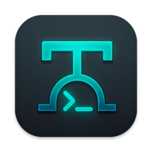

<h1 align="center">Termina</h1>

  <b>Client SSH nativo per iPhone, iPad e Mac.</b> 
  Veloce, leggero e riservato: password e chiavi non lasciano mai il tuo dispositivo.

  <a href="README.md">English</a> · <b>Italiano</b>

  
  
  

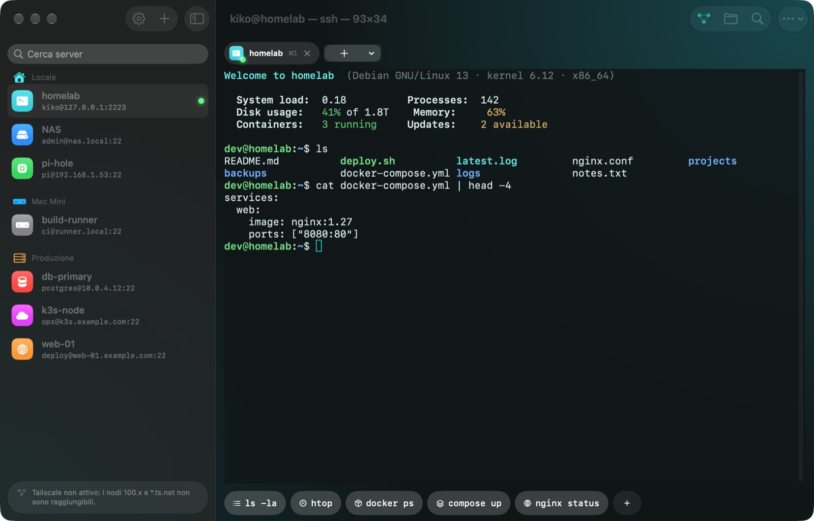

## Indice

- [Funzioni](#funzioni)
- [Requisiti di sistema](#requisiti-di-sistema)
- [Download](#download)
- [Guida all'uso](#guida-alluso)
  - [1. Aggiungere un server](#1-aggiungere-un-server)
  - [2. Connessione rapida](#2-connessione-rapida)
  - [3. Usare il terminale](#3-usare-il-terminale)
  - [4. Command Deck e tastiera](#4-command-deck-e-tastiera)
  - [5. File (SFTP)](#5-file-sftp)
  - [6. Port forwarding (tunnel)](#6-port-forwarding-tunnel)
  - [7. Sessioni che sopravvivono: tmux](#7-sessioni-che-sopravvivono-tmux)
  - [8. Impostazioni e lingua](#8-impostazioni-e-lingua)
  - [9. Sincronizzazione tra iPhone, iPad e Mac](#9-sincronizzazione-tra-iphone-ipad-e-mac)
  - [10. Handoff: continuare su un altro dispositivo](#10-handoff-continuare-su-un-altro-dispositivo)
  - [11. L'assistente](#11-lassistente)
  - [12. Snippet e cronologia](#12-snippet-e-cronologia)
  - [13. Importare da ~/.ssh](#13-importare-da-ssh)
  - [14. Jump host](#14-jump-host)
  - [15. Inoltro dell'agente SSH](#15-inoltro-dellagente-ssh)
  - [16. Siri, Comandi rapidi e Spotlight](#16-siri-comandi-rapidi-e-spotlight)
  - [17. Due sessioni affiancate](#17-due-sessioni-affiancate)
  - [18. Guida interna](#18-guida-interna)
  - [Scorciatoie da tastiera](#scorciatoie-da-tastiera)
- [Sicurezza e privacy](#sicurezza-e-privacy)
- [Risoluzione dei problemi](#risoluzione-dei-problemi)
- [Supporto](#supporto)

## Funzioni

- **Terminale vero**: xterm-256color con rendering su GPU (Metal), truecolor, vim, htop, tmux, profili colore.
- **Tab**: più server aperti insieme, si passa dall'uno all'altro con ⌘1…⌘9.
- **Due sessioni affiancate** su iPad e Mac, una accanto all'altra o una sopra l'altra: i log di un server mentre lavori su un altro.
- **Connessione rapida**: scrivi `utente@host` e sei dentro, come `ssh` nel Terminale.
- **Command Deck**: Esc, Tab, Ctrl, Alt, frecce, simboli e le tue macro a un tocco.
- **File (SFTP)** accanto al terminale: carica, scarica, anteprima, modifica dei file di testo, permessi.
- **Port forwarding**: tunnel locali (-L) e remoti (-R) con stato e traffico in tempo reale.
- **Credenziali sicure**: password e chiavi nel Portachiavi, sbloccate con Face ID o Touch ID; chiavi hardware
  generate nel **Secure Enclave**, che non possono mai essere copiate.
- **Snippet e cronologia**: comandi salvati con `{{variabili}}` per tutti i server, e la cronologia di ogni server.
- **Import da `~/.ssh`**: server, chiavi, jump host, tunnel e host key in un colpo solo.
- **Jump host e inoltro dell'agente**: raggiungi i server dietro un bastion; usa la tua chiave per `git` sul server.
- **Siri, Comandi rapidi e Spotlight**: «Connetti a homelab con Termina», un tocco da Comandi rapidi o Spotlight.
- **Assistente sul dispositivo**: chiedi "trova i file più grandi" o "spiegami questo errore" e ottieni il
  comando giusto con una spiegazione semplice. Usa Apple Intelligence sul dispositivo: niente esce da lì.
- **Handoff**: inizi sul Mac, continui sull'iPad con un tocco, sullo stesso server.
- **Sincronizzazione iCloud**: server, macro, tunnel, password e chiavi su tutti i tuoi iPhone, iPad e Mac,
  cifrati end-to-end, senza creare account.
- **Tailscale** riconosciuto da solo; **tmux** tiene viva la shell quando la connessione cade.
- 5 lingue: italiano, English, Français, Deutsch, Español.

| | |
|---|---|
| 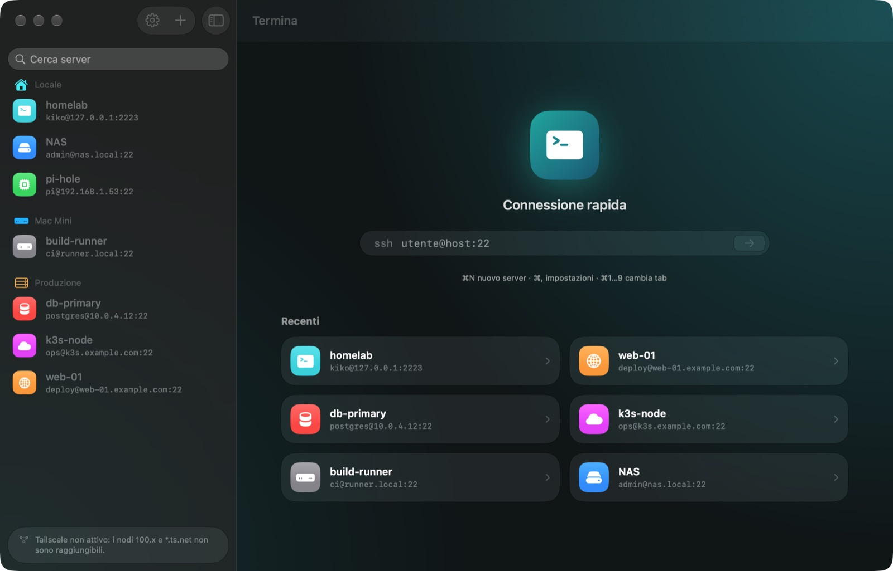 | 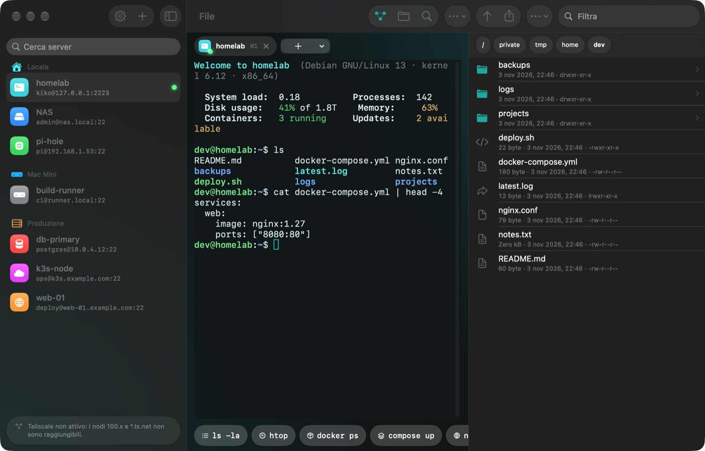 |
| Schermata iniziale, server recenti e connessione rapida | Terminale con il pannello File |
| 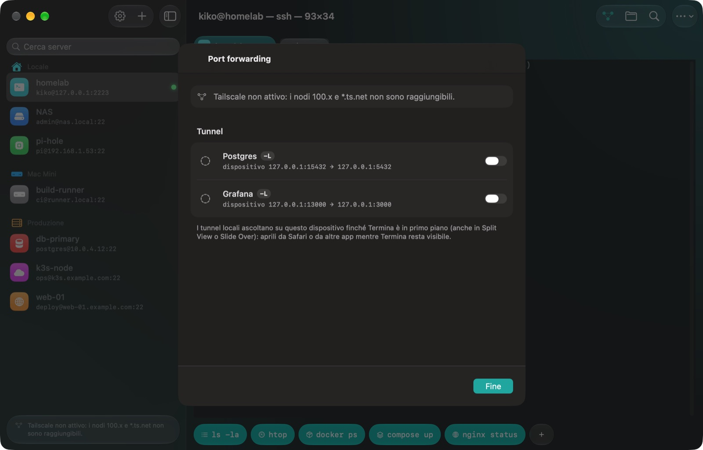 | 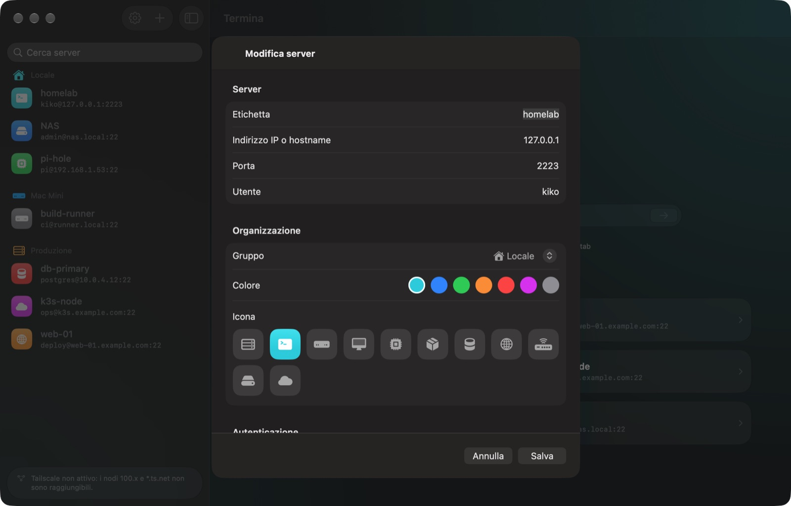 |
| Port forwarding con stato in tempo reale | Modifica di un server: icona, colore, gruppo, autenticazione |
| 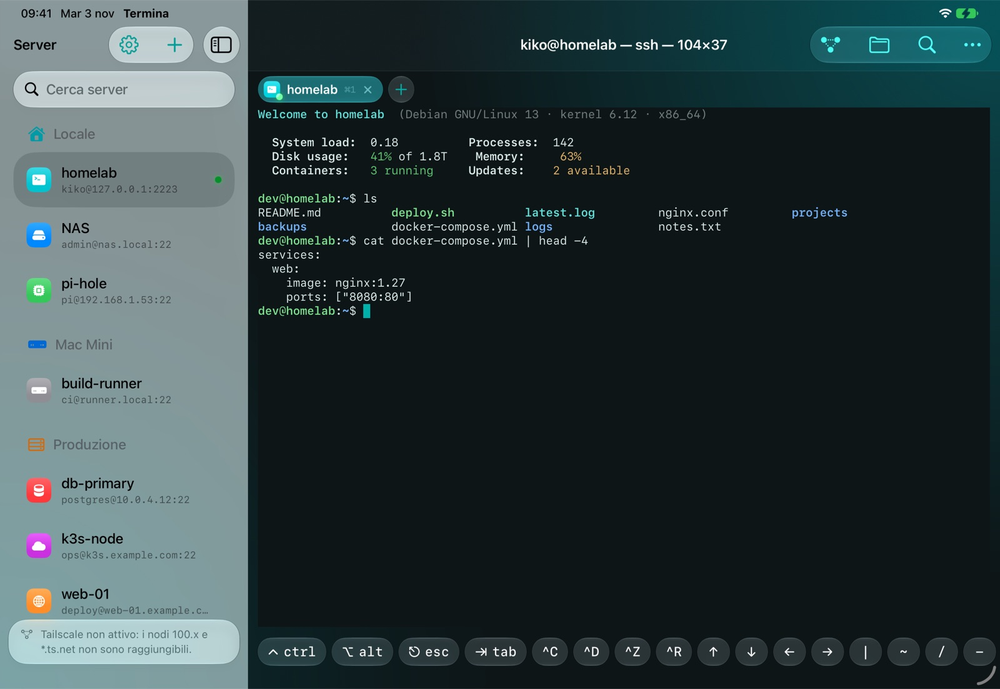 | 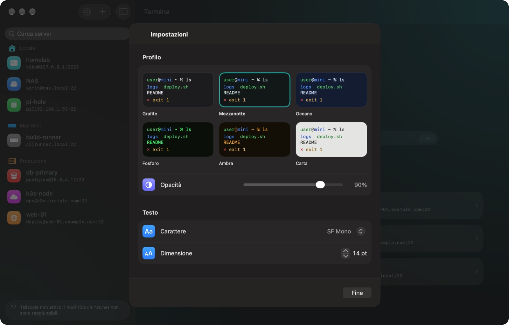 |
| iPad con la Command Deck | Impostazioni |
| 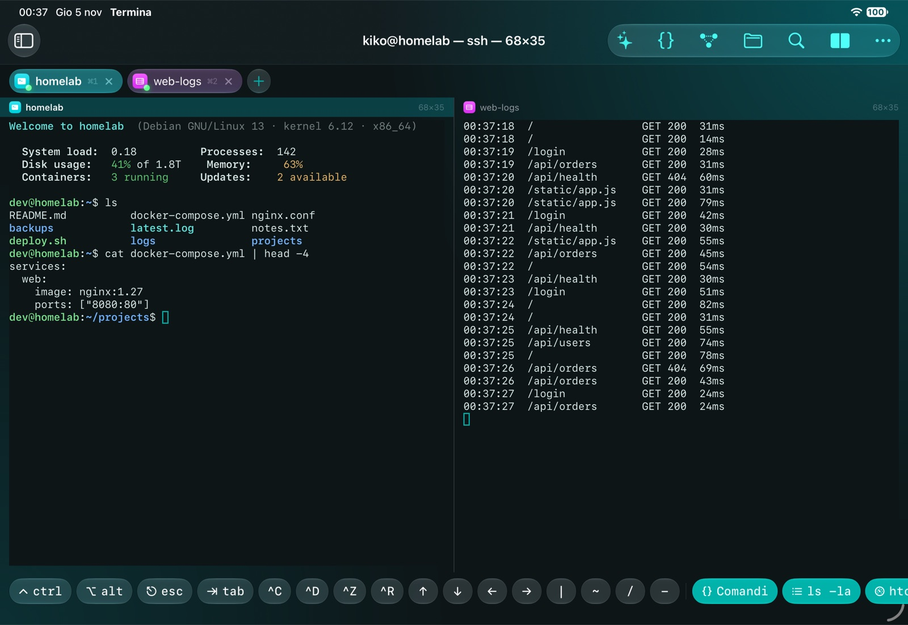 | 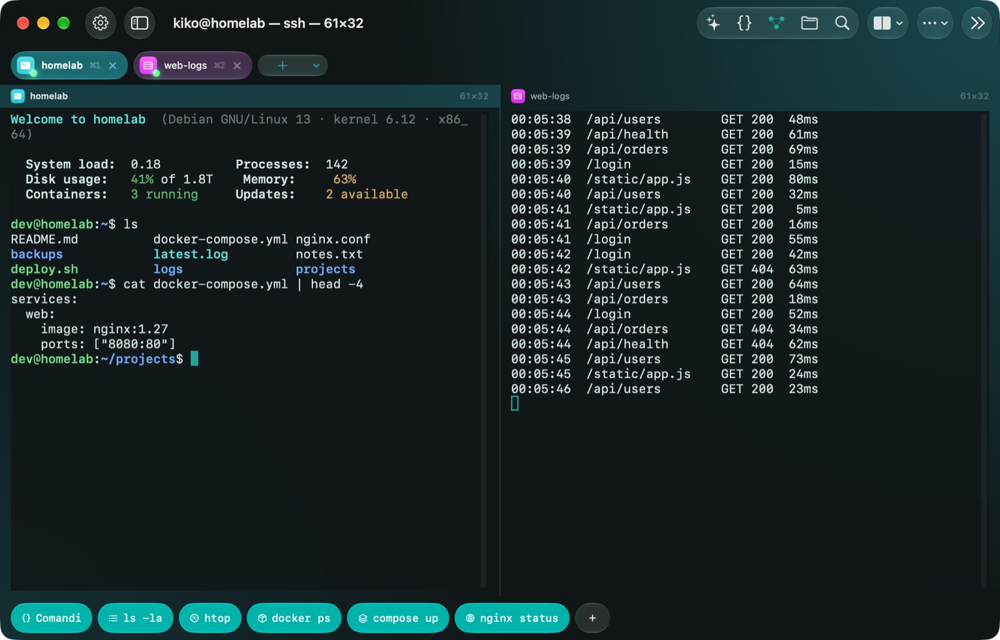 |
| Due sessioni affiancate su iPad | …e sul Mac |
| 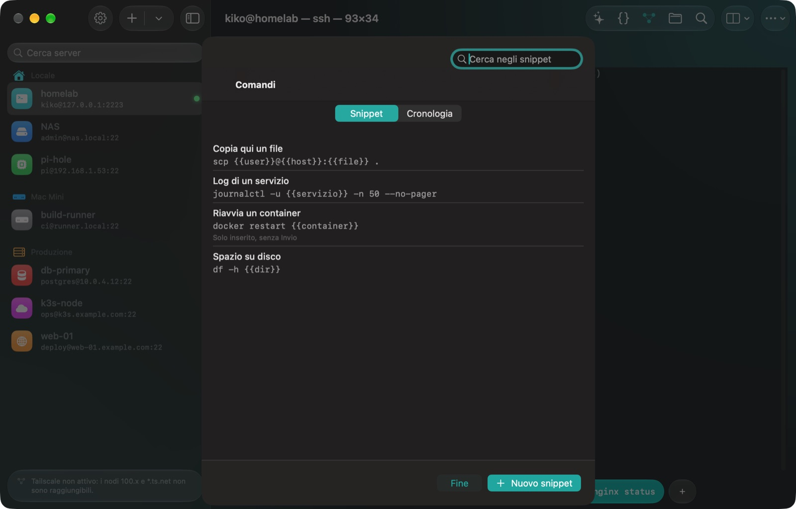 | 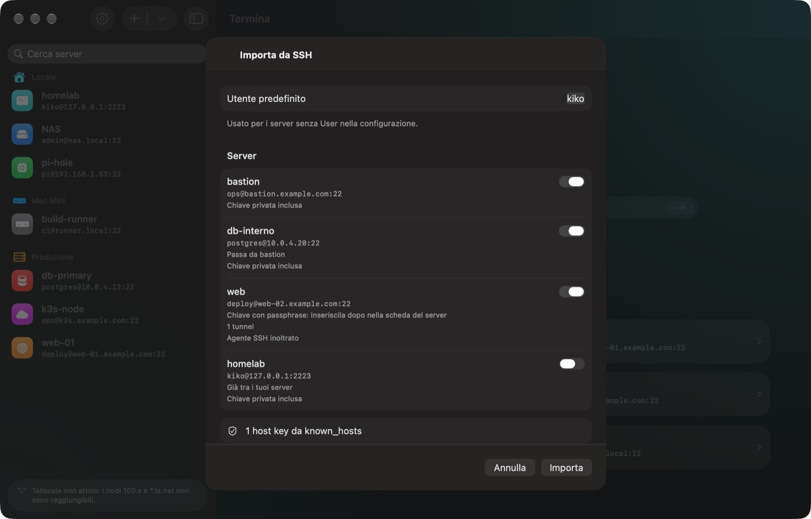 |
| Snippet con le `{{variabili}}` | Import da `~/.ssh`, con anteprima |

  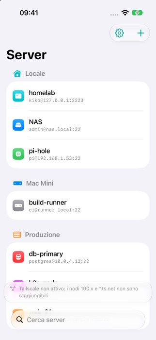
  &nbsp;
  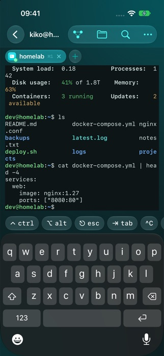
  &nbsp;
  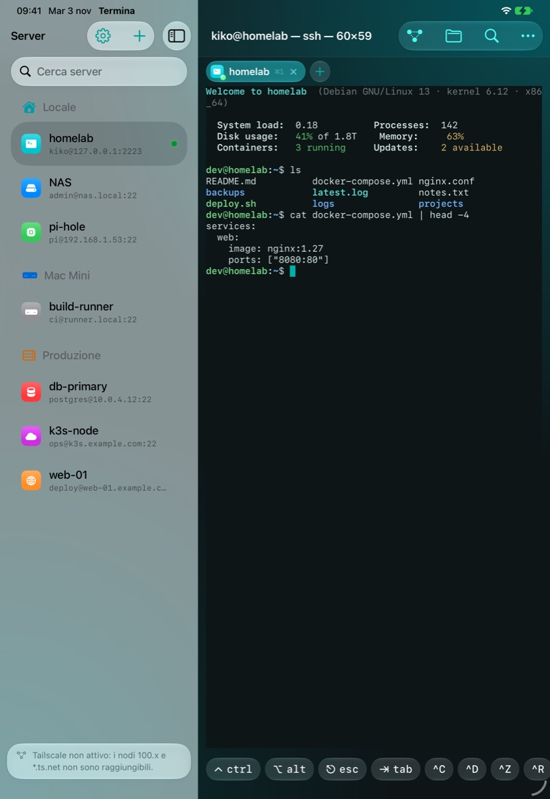

## Requisiti di sistema

| | iPhone | iPad | Mac |
|---|---|---|---|
| **Sistema operativo** | iOS 17 o successivo | iPadOS 17 o successivo | macOS 15 Sequoia o successivo |
| **Dispositivi** | iPhone XS, XR o successivi | iPad (6ª gen.), iPad mini (5ª gen.), iPad Air (3ª gen.), iPad Pro (2ª gen.) o successivi | Apple silicon (M1 o successivi) o Mac Intel che eseguono macOS 15 |
| **Aspetto Liquid Glass** | iOS 26 | iPadOS 26 | macOS 26 Tahoe |
| **Sblocco delle credenziali** | Face ID, Touch ID o codice (il codice deve essere impostato) | Face ID, Touch ID o codice (il codice deve essere impostato) | Touch ID o password del Mac |
| **Chiavi Secure Enclave** | Tutti gli iPhone supportati | Tutti gli iPad supportati | Apple silicon, o Mac Intel con chip T2 |
| **Tastiera fisica** | Facoltativa | Facoltativa (Magic Keyboard, Smart Keyboard, Bluetooth) | Integrata |

Sui sistemi precedenti l'app funziona allo stesso modo, con l'aspetto classico (senza vetro). Serve poi un server
SSH a cui collegarsi (Linux, macOS, BSD, Raspberry Pi, NAS, router…) raggiungibile dal dispositivo: in rete
locale, via Internet o tramite una VPN come Tailscale.

## Download

Termina arriverà sull'App Store per iPhone, iPad e Mac. La **versione per Mac** si scarica già dalla pagina
[Releases](https://github.com/kikoz85/Termina/releases) di questo repository, dove esce ogni nuova versione con
le sue note di rilascio.

## Guida all'uso

### 1. Aggiungere un server

1. Premi **+** in cima all'elenco dei server (oppure ⌘N).
2. Compila **Indirizzo** (IP o hostname), **Porta** (di solito 22) e **Utente**. L'**Etichetta** è il nome che vedrai nell'elenco.
3. Facoltativo: scegli un **gruppo** (Locale, Mac Mini, Produzione), un **colore** e un'**icona**, per riconoscerlo a colpo d'occhio.
4. Scegli come accedere:
   - **Password**: la scrivi una volta e resta nel Portachiavi.
   - **Chiave**: importa una chiave privata OpenSSH (Ed25519 o RSA) da File, con la passphrase se ce l'ha.
   - **Secure Enclave**: Termina crea una chiave dentro il chip del dispositivo. Copia la chiave pubblica mostrata
     e aggiungila a `~/.ssh/authorized_keys` sul server. La chiave privata non si può mai esportare né copiare.
5. Premi **Salva**, poi tocca il server per collegarti.

Alla prima connessione Termina mostra il **fingerprint** del server: confrontalo con quello del server
(`ssh-keygen -lf /etc/ssh/ssh_host_ed25519_key.pub`) e scegli **Considera attendibile**. Se un giorno cambia,
Termina rifiuta la connessione e ti avvisa: può essere un attacco, oppure il server è stato reinstallato.

### 2. Connessione rapida

Nella schermata iniziale scrivi `utente@host` (o `utente@host:porta`) accanto a `ssh` e premi Invio.
Termina si collega subito e chiede la password, come fa `ssh`. La password resta in memoria solo per quella
sessione. Per tenere il server apri il menu della sessione (**⋯**) e scegli **Salva server**: la password che
hai scritto è già compilata.

Se l'indirizzo corrisponde a un server già salvato, si apre direttamente la sua sessione.

### 3. Usare il terminale

- Ogni server si apre in una **tab**. Il **+** accanto alle tab apre un altro server; **×** chiude la tab.
- Il titolo mostra `utente@host — processo — colonne×righe`.
- **Pizzica** lo schermo (o ⌘+ / ⌘-) per cambiare la dimensione del testo.
- **⌘F** cerca nell'output; **⌘K** pulisce lo schermo e lo scrollback.
- Seleziona il testo per copiarlo; i link nell'output si aprono direttamente.
- Se la connessione cade, una scheda mostra il motivo con **Riconnetti** e **Modifica server** (per correggere
  indirizzo, utente o password senza uscire dalla sessione).

### 4. Command Deck e tastiera

La barra sotto il terminale (la **Command Deck**) ti dà i tasti che la tastiera touch non ha:

- **ctrl** e **alt** restano bloccati per il tasto successivo: tocca **ctrl**, poi **c** per inviare Control-C.
- **esc**, **tab**, frecce, `|` `~` `/` `-` e scorciatoie come **^C ^D ^Z ^R**.
- **Macro**: pulsanti che scrivono un intero comando (`ls -la`, `htop`, `docker ps`…). Premi **+** per aggiungerne
  di tue, con nome, icona e la scelta se eseguirle subito. Le macro sono di ciascun server.

Con una **tastiera fisica** (Magic Keyboard su iPad, o quella del Mac) la Deck può mostrare solo le macro o
sparire del tutto: vedi *Impostazioni → Tastiera → Command Deck*. **⌘.** invia sempre Esc, anche dalle tastiere senza
il tasto Esc. **Option come Meta** fa inviare a Option la sequenza Esc+tasto (utile in Emacs, bash e tmux); disattivalo per scrivere lettere accentate con Option.

### 5. File (SFTP)

Premi il pulsante **cartella** nella barra (⇧⌘F) per aprire i file del server accanto al terminale.

- Tocca una cartella per aprirla; tocca il percorso in alto per tornare indietro; **↑** va alla cartella superiore.
- Tocca un file di testo per **modificarlo**; gli altri file si aprono in **Quick Look**.
- **Carica** con il pulsante di condivisione o **trascinando** i file; tieni premuto (o clic destro) su un file per
  **salvarlo**, **rinominarlo**, cambiare i **permessi**, copiarne il percorso o eliminarlo.
- **Apri nel terminale** esegue `cd` in quella cartella nella shell.

### 6. Port forwarding (tunnel)

I tunnel servono a raggiungere servizi che vede solo il server, per esempio un database o un pannello di amministrazione.
Premi il pulsante **tunnel** nella barra (⇧⌘T), poi **+**:

- **Locale (-L)**: ascolta sul tuo dispositivo e inoltra al server. Esempio: dispositivo `127.0.0.1:5432` → server
  `127.0.0.1:5432` ti permette di aprire il PostgreSQL del server dalle app del tuo iPad o Mac.
- **Remoto (-R)**: ascolta sul server e inoltra al tuo dispositivo o alla tua rete.

Ogni tunnel mostra lo stato e il traffico in tempo reale; i tunnel web si aprono nel browser con un tocco. Su iPhone
e iPad i tunnel locali funzionano finché Termina è in primo piano (anche in Split View e Slide Over).

### 7. Sessioni che sopravvivono: tmux

iOS chiude le connessioni di rete circa 30 secondi dopo che un'app passa in background. Per non interrompere i
lavori lunghi, scrivi un nome in **Sessione tmux** quando modifichi un server: Termina avvia
`tmux new-session -A -s <nome>` dopo l'accesso e si riaggancia alla stessa shell quando si riconnette. Sul server
deve essere installato `tmux`.

### 8. Impostazioni e lingua

Apri le **Impostazioni** con l'ingranaggio (o ⌘,):

- **Profilo**: sei temi colore con anteprima dal vivo, e l'opacità.
- **Testo**: carattere e dimensione. **Cursore**: forma e lampeggio.
- **Tastiera**: Option come Meta e comportamento della Command Deck.
- **Lingua**: *Automatica* segue la lingua del sistema (inglese se la tua lingua non è disponibile), oppure
  scegli English, Italiano, Français, Deutsch o Español. La nuova lingua vale dalla prossima apertura dell'app;
  sul Mac puoi riavviarla subito.

In **Impostazioni → Informazioni** trovi la guida, la versione, le pagine di supporto e privacy e il link al sito
dello sviluppatore.

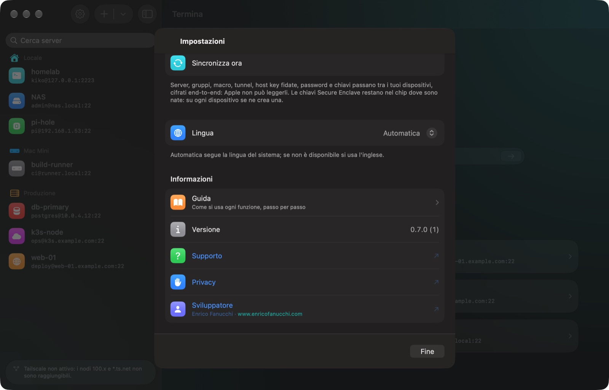

### 9. Sincronizzazione tra iPhone, iPad e Mac

Termina tiene allineati i tuoi dispositivi attraverso **il tuo iCloud**: non c'è un account Termina da creare.
È attiva di default (*Impostazioni → Sincronizzazione → iCloud*); basta aver fatto l'accesso con lo stesso
Apple Account su ogni dispositivo.

- **Cosa si sincronizza**: server (con gruppi, colori, icone), macro, tunnel, host key fidate, password e chiavi
  private. Aggiungi un server sul Mac e ti colleghi dall'iPad senza riscrivere la password.
- **Privacy**: tutto è cifrato end-to-end con chiavi del tuo Portachiavi iCloud; Apple non può leggerlo.
- **Cosa resta su ogni dispositivo**: le chiavi Secure Enclave (non escono mai dal chip: creane una per
  dispositivo e aggiungi ogni chiave pubblica ad `authorized_keys`) e l'elenco dei server recenti.
- Le modifiche arrivano in pochi secondi; **Sincronizza ora** nelle Impostazioni forza un controllo. Se due
  dispositivi modificano lo stesso server, vince la modifica più recente.
- Le password salvate prima di attivare la sincronizzazione partono la prima volta che le usi per collegarti.

### 10. Handoff: continuare su un altro dispositivo

Mentre una sessione è aperta su un dispositivo, Termina la offre agli altri: l'icona di Termina compare in fondo
al **Dock** su Mac e iPad e nel **selettore app** su iPhone. Toccala e lì si apre lo stesso server.

- Con una **sessione tmux** impostata per il server ritrovi la stessa identica shell, con tutto ancora in corso.
- Senza tmux ottieni una shell nuova nella **stessa cartella**, se la shell la comunica (sequenza OSC 7; in bash
  aggiungi a `~/.bashrc` `PROMPT_COMMAND='printf "\e]7;file://%s%s\e\\" "$HOSTNAME" "$PWD"'`).
- Serve lo stesso Apple Account, Bluetooth e Wi‑Fi attivi e **Handoff** abilitato (Impostazioni → Generali →
  AirPlay e Continuity su iPhone/iPad, Impostazioni di Sistema → Generali → AirDrop e Handoff sul Mac).

### 11. L'assistente

Durante una sessione tocca **✦ Assistente** nella barra in alto (⇧⌘I).

- **Cosa vuoi fare?** Scrivilo con parole tue, in una delle lingue dell'app: "trova i file più grandi",
  "chi è collegato?", "fammi vedere gli errori di nginx".
- **Spiega l'output del terminale**: spiega quello che vedi, per esempio un errore, e il passo successivo.
- **Spiega un comando**: incolla un comando per sapere cosa fa prima di lanciarlo.

I comandi **Dal ricettario di Termina** sono controllati a mano; quelli **Generati** vanno verificati. Un avviso
arancione segnala i comandi che cancellano o modificano qualcosa. L'assistente non esegue mai nulla:
**Inserisci** scrive il comando nel terminale e lo lanci tu con Invio. Serve Apple Intelligence (iPhone 15 Pro
o successivi, iPad e Mac con Apple silicon, iOS/iPadOS/macOS 26); funziona anche offline.

### 12. Snippet e cronologia

Durante una sessione tocca **{} Comandi** nella Command Deck o nella barra in alto (⇧⌘S).

- Gli **snippet** sono comandi salvati che valgono per tutti i server e arrivano sugli altri dispositivi con
  iCloud. Tocca **+**, dai un nome e un comando, scegli se eseguirlo subito o solo scriverlo.
- Le variabili tra doppie graffe adattano il comando: `{{host}}`, `{{user}}`, `{{port}}`, `{{label}}` e
  `{{dir}}` (la cartella corrente) si riempiono da sole; qualsiasi altro nome, come `{{servizio}}` in
  `journalctl -u {{servizio}}`, viene chiesto ogni volta.
- La **cronologia** elenca i comandi dati in quel server, dal più recente. Toccane uno per riscriverlo; tienilo
  premuto per eseguirlo o salvarlo come snippet. Resta sul dispositivo e, come la shell, salta i comandi che
  iniziano con uno spazio.

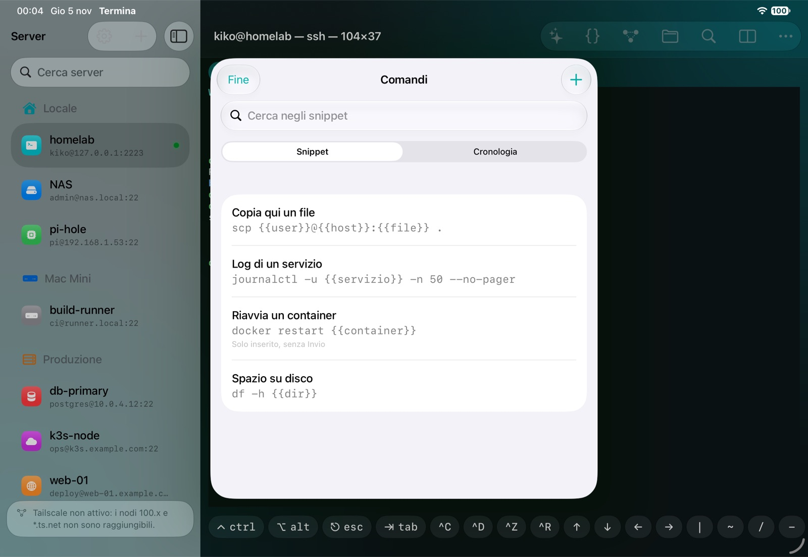

### 13. Importare da ~/.ssh

Se usi già `ssh` su un Mac o un PC, porta i server in Termina in un colpo solo: tieni premuto **+** nell'elenco
dei server (sul Mac anche **Archivio → Importa da ~/.ssh…**) e scegli la cartella `.ssh`. Sul Mac è nella
cartella Inizio ed è nascosta: nel pannello premi **⌘⇧.** per vederla. Su iPhone e iPad copiala prima in
iCloud Drive, oppure incolla il solo file `config`.

Termina legge `Host`, `HostName`, `User`, `Port`, `IdentityFile`, `ProxyJump`, `LocalForward`, `RemoteForward`
e `ForwardAgent`, include le chiavi private e considera attendibili le host key Ed25519 di `known_hosts` (anche
cifrate). Vedi un'anteprima e scegli cosa importare; i server che hai già sono deselezionati. I server senza
chiave chiedono la password al primo collegamento e poi la ricordano. I tuoi file non vengono mai modificati.

### 14. Jump host

Per un server raggiungibile solo attraverso un altro (un bastion): aggiungi il bastion come un server normale,
poi modifica la destinazione e sceglilo in **Instradamento → Jump host**. Termina passa da lì come `ssh -J`, con
un solo Face ID, e la connessione resta cifrata fino alla destinazione. Si possono concatenare fino a 4 salti.

### 15. Inoltro dell'agente SSH

Attiva **Instradamento → Inoltra l'agente SSH** per un server e i programmi che girano lì, come `git` o `ssh`,
potranno usare la chiave con cui sei entrato senza che venga mai copiata: per esempio `git pull` da GitHub con
la chiave dell'iPhone. Sul server `ssh-add -l` la mostra. Attivalo solo sui server di cui ti fidi: finché sei
collegato, chi controlla il server può usare la chiave. Funziona con chiavi Ed25519 e Secure Enclave.

### 16. Siri, Comandi rapidi e Spotlight

Le azioni di Termina compaiono da sole, con i tuoi server e i tuoi snippet. Non c'è niente da configurare:

- **Siri**: di' «Connetti a homelab con Termina» oppure «Apri homelab in Termina», con il nome del tuo server.
- **Comandi rapidi**: apri Termina nell'app Comandi rapidi. C'è un pulsante per ogni server e uno per ogni
  snippet (ti chiede su quale server eseguirlo). Puoi usarli anche nelle automazioni, nei widget e con il
  tasto Azione.
- **Spotlight**: scrivi il nome di un server e toccalo per collegarti (da iOS 18).

Termina si apre sempre prima di collegarsi: Face ID, conferma della host key e password funzionano come al
solito. Se uno snippet ha valori da riempire, l'app te li chiede prima di eseguirlo.

### 17. Due sessioni affiancate

Su iPad e Mac puoi tenere due sessioni sullo stesso schermo: per esempio i log di un server mentre lavori su
un altro.

1. Durante una sessione tocca **Affianca** (l'icona con due rettangoli) nella barra in alto e scegli una
   sessione aperta o un server salvato.
2. Tocca un riquadro per scriverci. Quello attivo ha l'intestazione colorata e riceve la tastiera, la Command
   Deck, i file e i tunnel.
3. Dallo stesso menu scegli **Uno sopra l'altro** o **Uno accanto all'altro**, oppure **Chiudi riquadri** per
   tornare a una sessione sola.

Ogni riquadro ha la sua grandezza e il terminale adatta colonne e righe, anche quando si apre la tastiera o il
pannello File. Con la tastiera: **⌘D** affianca la tab successiva, **⌘⌥←** / **⌘⌥→** cambiano riquadro,
**⇧⌘D** torna a una sessione. Su iPhone e nelle finestre strette (Slide Over) si vede solo il riquadro attivo.

### 18. Guida interna

Ogni funzione è spiegata passo per passo dentro l'app: **Impostazioni → Guida**, il link **Come si usa Termina**
nella schermata iniziale o **Aiuto → Guida di Termina** (⌘?) sul Mac.

### Scorciatoie da tastiera

| Tasti | Azione |
|---|---|
| ⌘T / ⌘W | Nuova tab / chiudi tab |
| ⌘1…⌘9, ⇧⌘[ ⇧⌘] | Vai alla tab / precedente / successiva |
| ⌘K | Pulisci schermo e scrollback |
| ⌘F, ⌘G, ⇧⌘G | Trova, successivo, precedente |
| ⌘+ ⌘- ⌘0 | Dimensione del testo |
| ⌘. | Esc |
| ⇧⌘T | Tunnel |
| ⇧⌘S | Snippet e cronologia |
| ⌘D / ⇧⌘D | Affianca la tab successiva / una sessione sola |
| ⌘⌥← ⌘⌥→ | Cambia riquadro |
| ⇧⌘F, ⌘↑ | File, cartella superiore |
| ⌘N / ⌘, | Nuovo server / Impostazioni |
| ⌘R | Riconnetti |

Su iPad tieni premuto **⌘** per vedere tutte le scorciatoie.

## Sicurezza e privacy

- Password e chiavi private sono salvate solo nel **Portachiavi** del dispositivo, protette da Face ID, Touch ID o
  dal codice. Con la sincronizzazione iCloud attiva viaggiano anche nel tuo iCloud, cifrate end-to-end: né
  Apple né lo sviluppatore possono leggerle.
- Le chiavi Secure Enclave nascono dentro il chip e **non si possono estrarre**, nemmeno da Termina.
- L'identità di ogni server viene verificata (fingerprint della host key) per proteggerti dagli attacchi man-in-the-middle.
- Niente account, niente statistiche, nessun tracciamento: Termina si collega solo ai server che aggiungi tu (e, con la sincronizzazione attiva, al tuo iCloud).

Informativa completa: [Privacy](https://kikoz85.github.io/Termina/privacy.html).

## Risoluzione dei problemi

| Problema | Cosa fare |
|---|---|
| "Credenziale non trovata nel Portachiavi" | Apri **Modifica server** dalla scheda della sessione e scrivi di nuovo la password o reimporta la chiave. |
| "Autenticazione non riuscita" | Controlla utente e password. Per le chiavi, verifica che la chiave pubblica sia in `~/.ssh/authorized_keys` sul server. |
| "La host key è cambiata" | Se hai reinstallato il server, eliminalo da Termina e aggiungilo di nuovo. Altrimenti **non** collegarti. |
| `100.x.x.x` o `*.ts.net` non raggiungibili | Attiva la VPN Tailscale sul dispositivo. |
| La connessione cade in background | Usa una **sessione tmux** (vedi la guida, punto 7). |
| Le lettere accentate con Option non funzionano | Disattiva **Option come Meta** nelle Impostazioni. |
| Un server non compare su un altro dispositivo | Verifica di aver fatto l'accesso a iCloud con lo stesso Apple Account, poi **Impostazioni → Sincronizza ora**. |

## Supporto

- Aiuto e contatti: [pagina di Supporto](https://kikoz85.github.io/Termina/support.html)
- Bug e suggerimenti: apri una [issue](https://github.com/kikoz85/Termina/issues) o scrivi a enricofanucchi@gmail.com
- Sostieni lo sviluppo: [GitHub Sponsors](https://github.com/sponsors/kikoz85)
- Sviluppatore: Enrico Fanucchi · [www.enricofanucchi.com](https://www.enricofanucchi.com)

© 2026 Enrico Fanucchi
