

  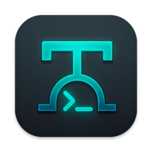

<h1 align="center">Termina</h1>

  <b>A native SSH client for iPhone, iPad and Mac, also on Windows, Linux and Android.</b> 
  Fast, light and private: your passwords and keys never leave your device.

  <b>English</b> · <a href="README.it.md">Italiano</a>

  
  
  

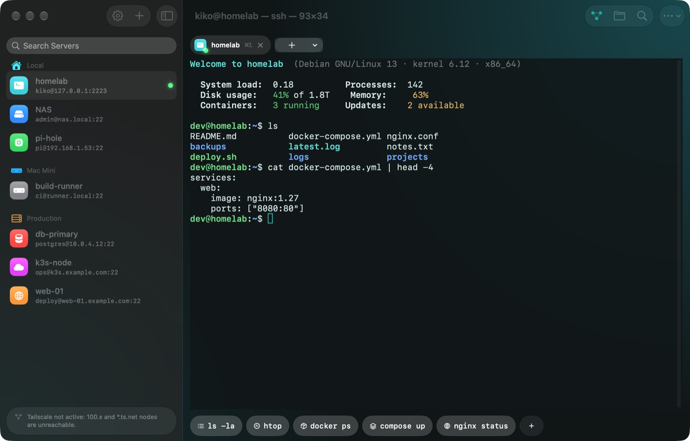

## Contents

- [Features](#features)
- [System requirements](#system-requirements)
- [Download](#download)
- [User guide](#user-guide)
  - [1. Add a server](#1-add-a-server)
  - [2. Quick Connect](#2-quick-connect)
  - [3. Using the terminal](#3-using-the-terminal)
  - [4. Command Deck and keyboard](#4-command-deck-and-keyboard)
  - [5. Files (SFTP)](#5-files-sftp)
  - [6. Port forwarding (tunnels)](#6-port-forwarding-tunnels)
  - [7. Sessions that survive: tmux](#7-sessions-that-survive-tmux)
  - [8. Settings and language](#8-settings-and-language)
  - [9. Sync between iPhone, iPad and Mac](#9-sync-between-iphone-ipad-and-mac)
  - [10. Handoff: continue on another device](#10-handoff-continue-on-another-device)
  - [11. The assistant](#11-the-assistant)
  - [12. Snippets and history](#12-snippets-and-history)
  - [13. Import from ~/.ssh](#13-import-from-ssh)
  - [14. Jump hosts](#14-jump-hosts)
  - [15. SSH agent forwarding](#15-ssh-agent-forwarding)
  - [16. Siri, Shortcuts and Spotlight](#16-siri-shortcuts-and-spotlight)
  - [17. Two sessions side by side](#17-two-sessions-side-by-side)
  - [18. Built-in guide](#18-built-in-guide)
  - [Keyboard shortcuts](#keyboard-shortcuts)
- [Security and privacy](#security-and-privacy)
- [Troubleshooting](#troubleshooting)
- [Support](#support)

## Features

- **Real terminal**: xterm-256color with GPU (Metal) rendering, true colour, vim, htop, tmux, colour profiles.
- **Tabs**: several servers open at once, switch with ⌘1…⌘9.
- **Two sessions side by side** on iPad and Mac, next to each other or stacked: logs on one server while you work on another.
- **Quick Connect**: type `user@host` and you are in, like `ssh` in Terminal.
- **Command Deck**: Esc, Tab, Ctrl, Alt, arrows, symbols and your own one-tap macros.
- **Files (SFTP)** next to the terminal: upload, download, preview, edit text files, change permissions.
- **Port forwarding**: local (-L) and remote (-R) tunnels with live status and traffic.
- **Secure credentials**: passwords and keys in the Keychain, unlocked with Face ID or Touch ID;
  hardware keys generated in the **Secure Enclave** that can never be copied.
- **Snippets and history**: saved commands with `{{variables}}` for every server, and each server's history.
- **Import from `~/.ssh`**: your servers, keys, jump hosts, tunnels and host keys in one go.
- **Jump hosts and agent forwarding**: reach servers behind a bastion; use your key for `git` on the server.
- **Siri, Shortcuts and Spotlight**: “Connect to homelab with Termina”, one tap from Shortcuts or Spotlight.
- **On-device assistant**: ask "find the biggest files" or "explain this error" and get the right command
  with a plain explanation. It runs on Apple Intelligence on your device: nothing leaves it.
- **Handoff**: start on the Mac, continue on the iPad with one tap, on the same server.
- **iCloud sync**: servers, macros, tunnels, passwords and keys on all your iPhone, iPad and Mac,
  end-to-end encrypted, with no account to create.
- **Tailscale** detected automatically; **tmux** keeps your shell alive when the connection drops.
- 5 languages: English, Italiano, Français, Deutsch, Español.

| | |
|---|---|
| 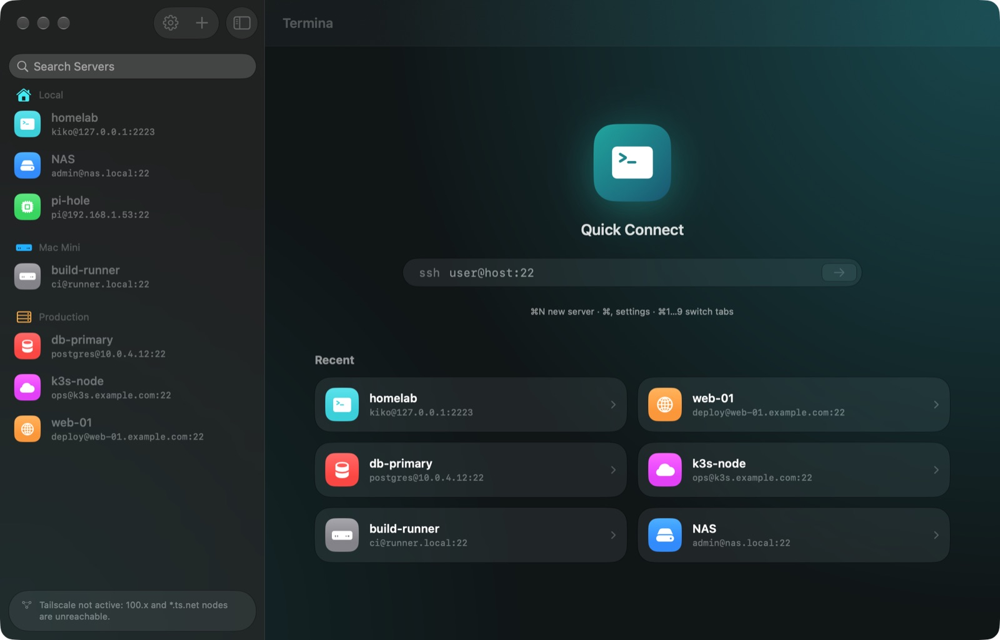 | 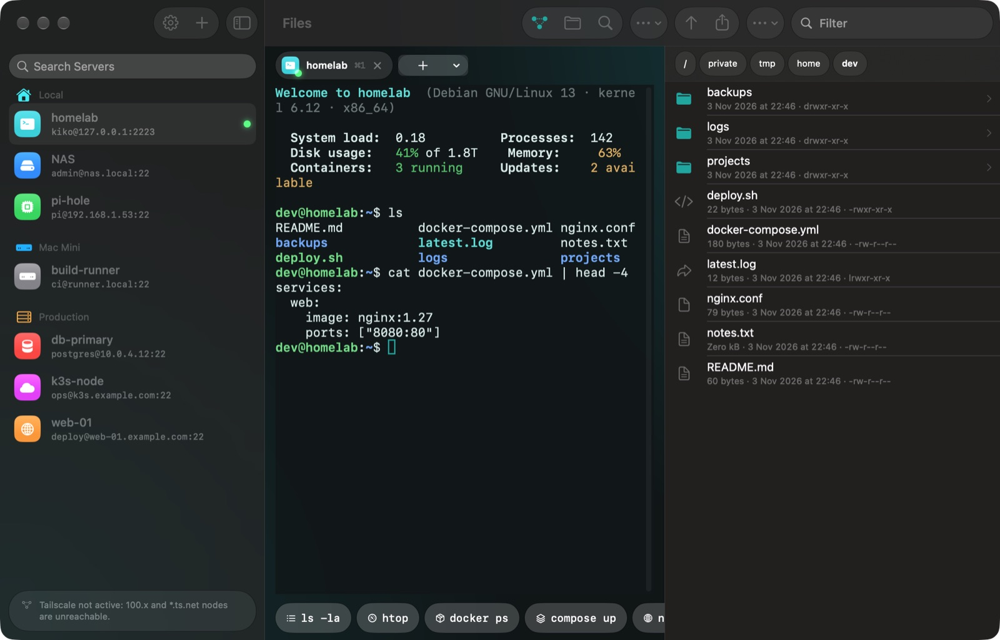 |
| Welcome screen, recent servers and Quick Connect | Terminal with the Files panel |
| 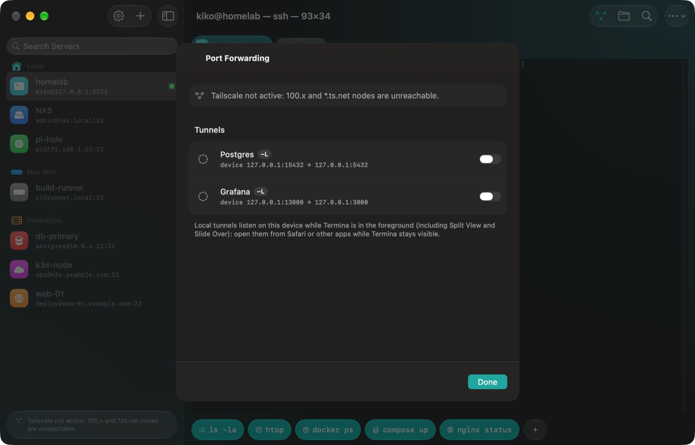 | 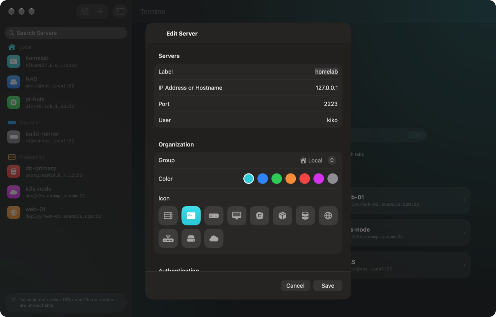 |
| Port forwarding with live status | Server editor: icon, colour, group, authentication |
| 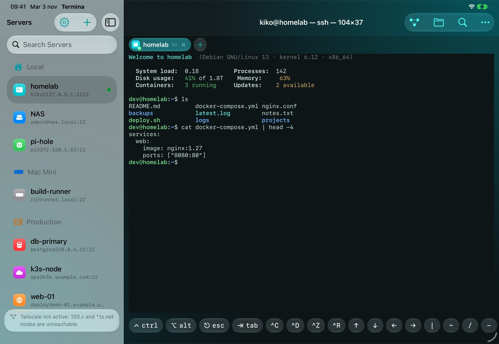 | 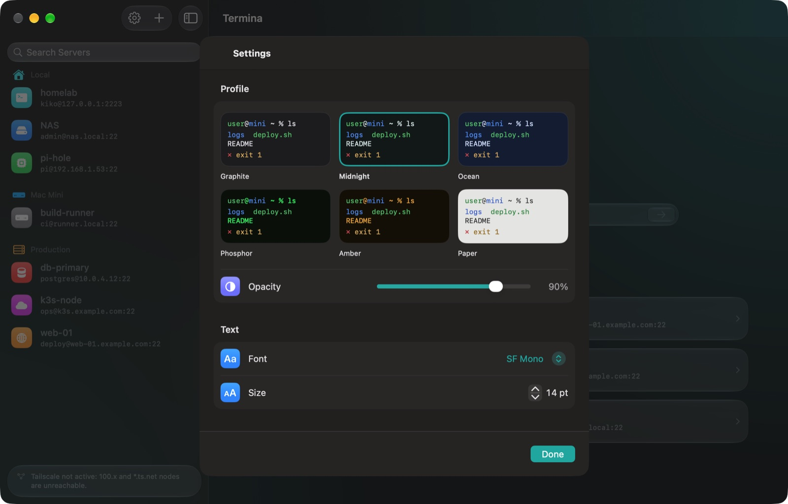 |
| iPad with the Command Deck | Settings |
| 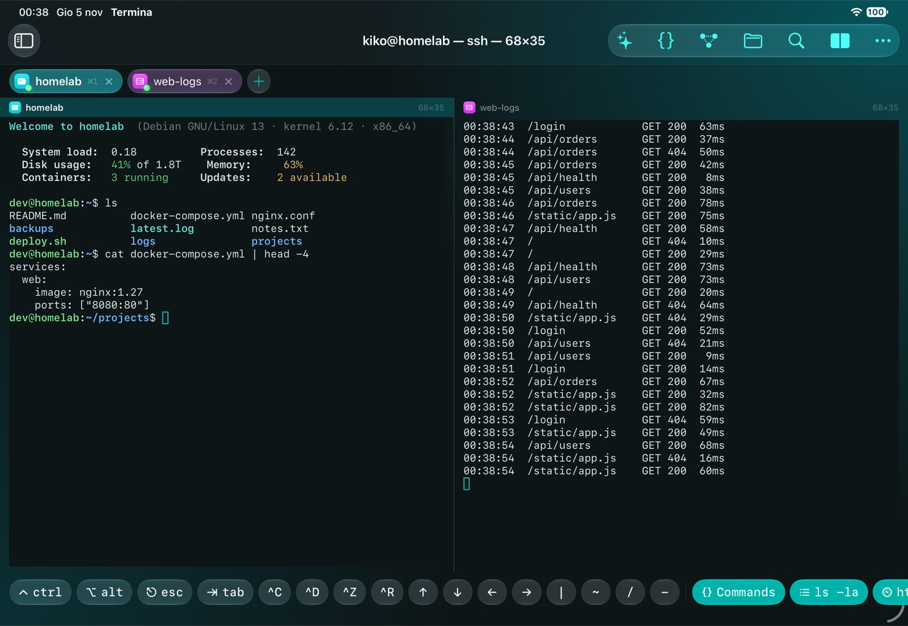 | 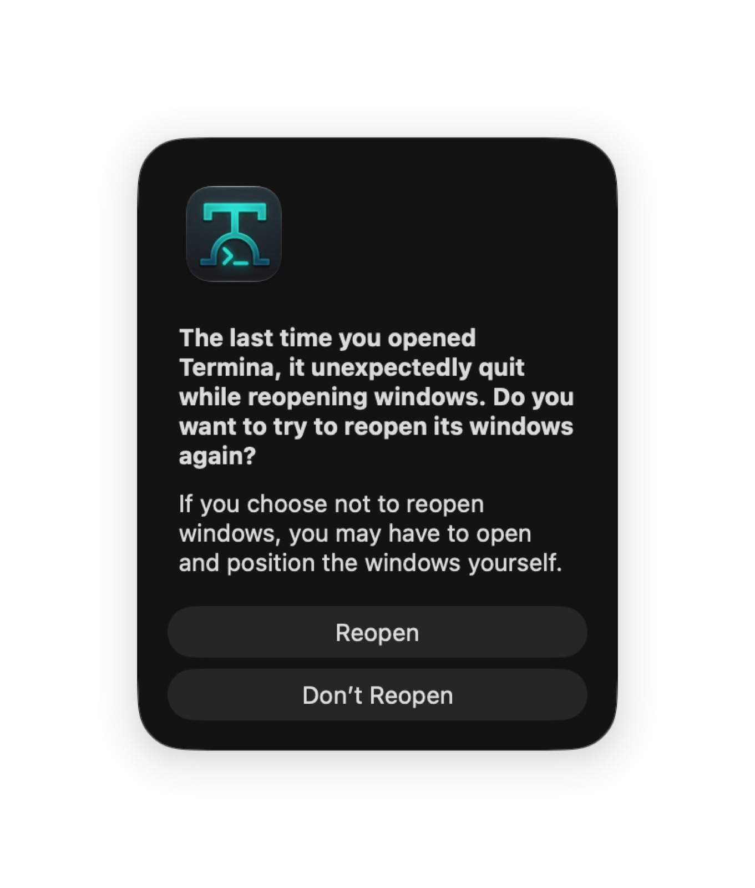 |
| Two sessions side by side on iPad | …and on the Mac |
| 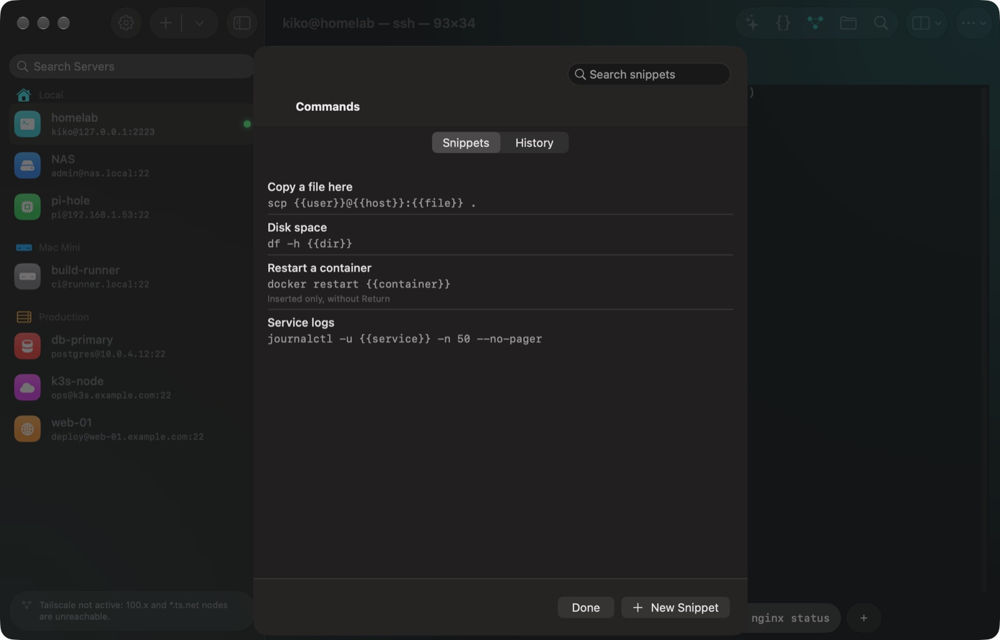 | 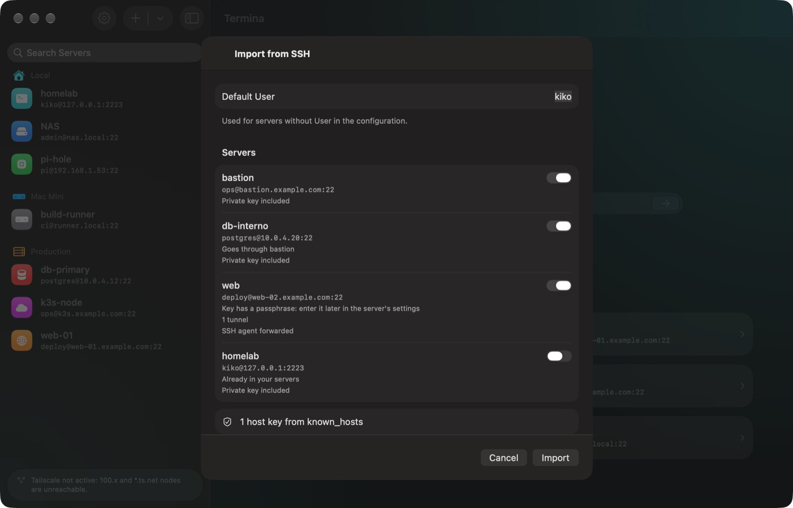 |
| Snippets with `{{variables}}` | Import from `~/.ssh`, with preview |

  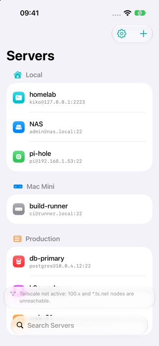
  &nbsp;
  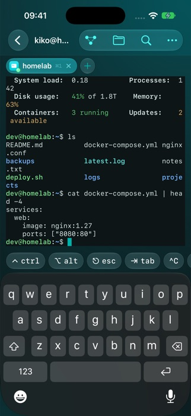
  &nbsp;
  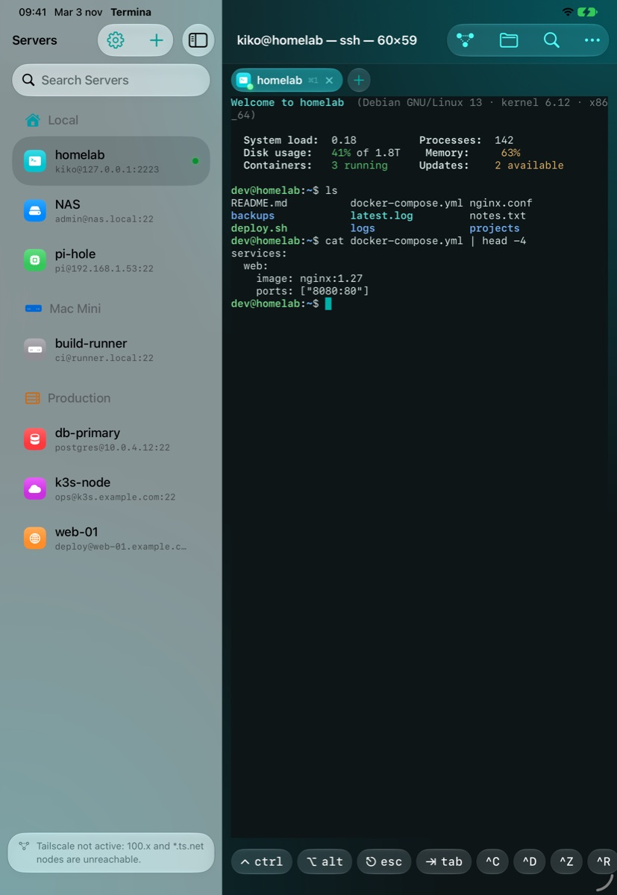

## System requirements

| | iPhone | iPad | Mac |
|---|---|---|---|
| **Operating system** | iOS 17 or later | iPadOS 17 or later | macOS 15 Sequoia or later |
| **Devices** | iPhone XS, XR or later | iPad (6th gen.), iPad mini (5th gen.), iPad Air (3rd gen.), iPad Pro (2nd gen.) or later | Apple silicon (M1 or later) or Intel Macs that run macOS 15 |
| **Liquid Glass look** | iOS 26 | iPadOS 26 | macOS 26 Tahoe |
| **Unlocking credentials** | Face ID, Touch ID or device passcode (a passcode must be set) | Face ID, Touch ID or passcode (a passcode must be set) | Touch ID or Mac password |
| **Secure Enclave keys** | All supported iPhones | All supported iPads | Apple silicon, or Intel Macs with the T2 chip |
| **Hardware keyboard** | Optional | Optional (Magic Keyboard, Smart Keyboard, Bluetooth) | Built in |

On older systems the app works the same, with a classic (non-glass) look. You also need an SSH server to
connect to (Linux, macOS, BSD, Raspberry Pi, NAS, router…) reachable from your device: on your network,
over the Internet or through a VPN such as Tailscale.

**Windows, Linux and Android**: Windows 10 or 11 (x64) and Windows 11 on ARM; Linux x64 or ARM64 with GTK 3
(Debian, Ubuntu, Fedora, Raspberry Pi OS 64-bit…); Android 7.0 or later, phones and tablets. Same interface:
phones look like iPhone, tablets and computers like iPad and Mac. Not available there: iCloud sync, Handoff,
Siri and Shortcuts, Spotlight, Secure Enclave keys and the assistant. In this guide, ⌘ is Ctrl on Windows and Linux.

## Download

Termina is coming to the App Store for iPhone, iPad and Mac. The versions for **Mac, Windows, Linux and Android**
can already be downloaded from the [Releases](https://github.com/kikoz85/Termina/releases) page of this repository,
where every new version is published with its release notes. They update themselves.

| System | Download |
|---|---|
| Mac (macOS 15+) | [Termina DMG](https://github.com/kikoz85/Termina/releases/download/v0.9.0/Termina-0.8.1.dmg), signed and notarized by Apple |
| Windows x64 | [Installer](https://github.com/kikoz85/Termina/releases/download/v0.9.0/Termina-0.9.0-windows-x64-setup.exe) |
| Windows ARM64 | [Installer](https://github.com/kikoz85/Termina/releases/download/v0.9.0/Termina-0.9.0-windows-arm64-setup.exe) |
| Linux x64 | [.deb](https://github.com/kikoz85/Termina/releases/download/v0.9.0/termina_0.9.0_amd64.deb) · [.tar.gz](https://github.com/kikoz85/Termina/releases/download/v0.9.0/Termina-0.9.0-linux-x64.tar.gz) |
| Linux ARM64 | [.deb](https://github.com/kikoz85/Termina/releases/download/v0.9.0/termina_0.9.0_arm64.deb) · [.tar.gz](https://github.com/kikoz85/Termina/releases/download/v0.9.0/Termina-0.9.0-linux-arm64.tar.gz) |
| Android | [APK](https://github.com/kikoz85/Termina/releases/download/v0.9.0/Termina-0.9.0-android-arm64.apk) (most phones and tablets); older 32-bit devices and x86_64 on the [release page](https://github.com/kikoz85/Termina/releases/latest) |

- **Windows**: installs for your user, no administrator needed. The installer is not signed with a certificate yet,
  so SmartScreen may warn you: choose *More info › Run anyway*.
- **Linux**: `sudo apt install ./termina_<version>_amd64.deb`, or extract the `.tar.gz` anywhere and run `termina`.
  Passwords and keys go to the GNOME or KDE keyring.
- **Android**: open the APK and allow installing from that source.

## User guide

### 1. Add a server

1. Press **+** at the top of the server list (or ⌘N).
2. Fill in **Address** (IP or hostname), **Port** (usually 22) and **User**. The **Label** is the name you will see in the list.
3. Optional: pick a **group** (Local, Mac Mini, Production), a **colour** and an **icon**, so you can find it at a glance.
4. Choose how to sign in:
   - **Password**: typed once and saved in the Keychain.
   - **Key**: import an OpenSSH private key (Ed25519 or RSA) from Files, with its passphrase if it has one.
   - **Secure Enclave**: Termina creates a key inside your device's chip. Copy the public key shown and add it
     to `~/.ssh/authorized_keys` on the server. The private key can never be exported or copied.
5. Press **Save**, then tap the server to connect.

The first time you connect, Termina shows the server's **fingerprint**: compare it with the server's own
(`ssh-keygen -lf /etc/ssh/ssh_host_ed25519_key.pub`) and choose **Trust**. If it ever changes, Termina refuses
to connect and warns you: it may be an attack, or the server was reinstalled.

### 2. Quick Connect

On the welcome screen, type `user@host` (or `user@host:port`) next to `ssh` and press Return.
Termina connects straight away and asks for the password, like `ssh` does. The password stays in memory only for that
session. To keep the server, open the session menu (**⋯**) and choose **Save Server**: the password you typed is filled in for you.

If the address matches a server you already saved, its saved session opens instead.

### 3. Using the terminal

- Each server opens in a **tab**. The **+** next to the tabs opens another server; **×** closes the tab.
- The title shows `user@host — process — columns×rows`.
- **Pinch** (or ⌘+ / ⌘-) to change the text size.
- **⌘F** searches the output; **⌘K** clears the screen and scrollback.
- Select text to copy it; links in the output can be opened directly.
- If the connection drops, a card shows the reason with **Reconnect** and **Edit Server** (to fix the address,
  user or password without leaving the session).

### 4. Command Deck and keyboard

The bar under the terminal (the **Command Deck**) gives you the keys a touch keyboard lacks:

- **ctrl** and **alt** stay locked for the next key: tap **ctrl**, then **c** to send Control-C.
- **esc**, **tab**, arrows, `|` `~` `/` `-` and shortcuts such as **^C ^D ^Z ^R**.
- **Macros**: buttons that type a whole command (`ls -la`, `htop`, `docker ps`…). Press **+** to add your own,
  with a name, an icon and the option to run it immediately. Macros belong to each server.

With a **hardware keyboard** (Magic Keyboard on iPad, or the Mac's own) the Deck can show only macros or hide
completely: see *Settings → Keyboard → Command Deck*. **⌘.** always sends Esc, even on keyboards without an Esc key.
**Option as Meta** makes Option send Esc+key (useful in Emacs, bash and tmux); turn it off to type accented letters with Option.

### 5. Files (SFTP)

Press the **folder** button in the toolbar (⇧⌘F) to open the files of the server next to the terminal.

- Tap a folder to open it; tap the path at the top to go back; **↑** goes to the parent folder.
- Tap a text file to **edit** it; other files open in **Quick Look**.
- **Upload** with the share button or by **dragging** files in; long-press (or right-click) a file to **save** it,
  **rename** it, change **permissions**, copy its path or delete it.
- **Open in Terminal** runs `cd` to that folder in the shell.

### 6. Port forwarding (tunnels)

Use tunnels to reach services that only the server can see, for example a database or an admin panel.
Press the **tunnel** button in the toolbar (⇧⌘T), then **+**:

- **Local (-L)**: listens on your device and forwards to the server. Example: device `127.0.0.1:5432` → server
  `127.0.0.1:5432` lets you open the server's PostgreSQL from apps on your iPad or Mac.
- **Remote (-R)**: listens on the server and forwards to your device or your network.

Each tunnel shows its state and live traffic; web tunnels can be opened in the browser with one tap. On iPhone and
iPad, local tunnels work while Termina is in the foreground (also in Split View and Slide Over).

### 7. Sessions that survive: tmux

iOS closes network connections about 30 seconds after an app goes to the background. To keep long jobs running,
type a name in **tmux session** when editing a server: Termina starts `tmux new-session -A -s <name>` after
login and reattaches to the same shell when it reconnects. `tmux` must be installed on the server.

### 8. Settings and language

Open **Settings** with the gear button (or ⌘,):

- **Profile**: six colour themes with live preview, and opacity.
- **Text**: font and size. **Cursor**: shape and blinking.
- **Keyboard**: Option as Meta and Command Deck behaviour.
- **Language**: *Automatic* follows your system language (English if your language is not available), or choose
  English, Italiano, Français, Deutsch or Español. The new language applies the next time the app opens; on Mac you can restart it right away.

**Settings → About** has the guide, the version, the support and privacy pages and a link to the developer's
website.

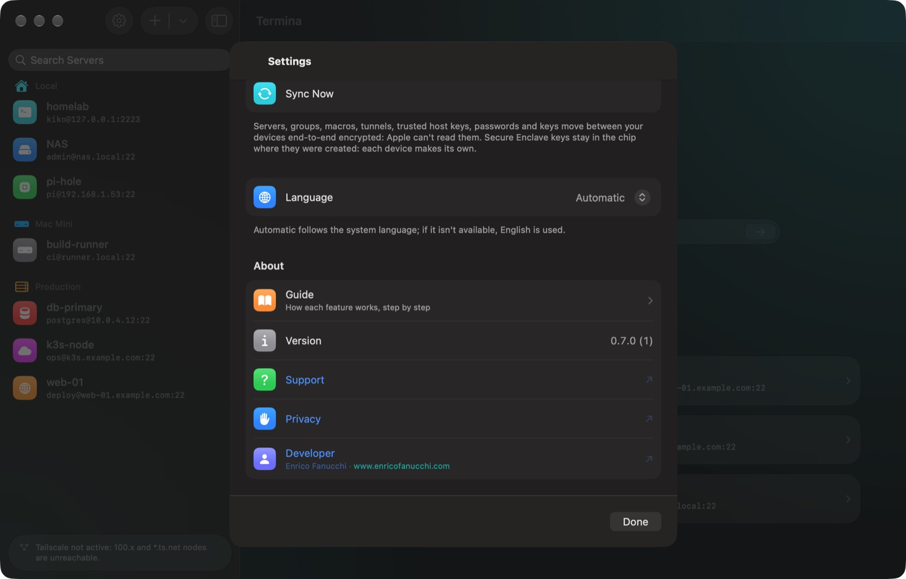

### 9. Sync between iPhone, iPad and Mac

Termina keeps your devices in step through **your own iCloud**: there is no Termina account to create.
It is on by default (*Settings → Sync → iCloud*); you only need to be signed in with the same Apple Account
on every device.

- **What syncs**: servers (with groups, colours, icons), macros, tunnels, trusted host keys, passwords and
  private keys. Add a server on the Mac and connect from the iPad without typing the password again.
- **Privacy**: everything is end-to-end encrypted with keys in your iCloud Keychain; Apple can't read it.
- **What stays on each device**: Secure Enclave keys (they never leave the chip: create one per device and
  add each public key to `authorized_keys`) and the list of recent servers.
- Changes arrive within seconds; **Sync Now** in Settings forces a check. If two devices edit the same
  server, the most recent change wins.
- Passwords saved before sync was turned on are uploaded the first time you connect with them.

### 10. Handoff: continue on another device

While a session is open on one device, Termina offers it to your others: the Termina icon appears at the
end of the **Dock** on the Mac and iPad, and in the **app switcher** on iPhone. Tap it and the same server
opens there.

- With a **tmux session** set for the server you land in the very same shell, with everything still running.
- Without tmux you get a new shell in the **same folder**, if your shell reports it (escape sequence OSC 7; in bash
  add to `~/.bashrc` `PROMPT_COMMAND='printf "\e]7;file://%s%s\e\\" "$HOSTNAME" "$PWD"'`).
- It needs the same Apple Account, Bluetooth and Wi‑Fi on, and **Handoff** enabled (Settings → General →
  AirPlay & Continuity on iPhone/iPad, System Settings → General → AirDrop & Handoff on Mac).

### 11. The assistant

During a session tap **✦ Assistant** in the toolbar (⇧⌘I).

- **What do you want to do?** Write it in your own words, in any of the app's languages: "find the biggest
  files", "who is logged in?", "show nginx errors".
- **Explain the terminal output**: explains what is on screen, for example an error, and the next step.
- **Explain a command**: paste a command to find out what it does before running it.

Commands marked **From the Termina Recipe Book** are checked by hand; **Generated** ones must be verified. An
orange warning flags commands that delete or change something. The assistant never runs anything: **Insert**
types the command into the terminal and you press Return. It needs Apple Intelligence (iPhone 15 Pro or later,
iPad and Mac with Apple silicon, iOS/iPadOS/macOS 26) and works offline.

### 12. Snippets and history

During a session tap **{} Commands** in the Command Deck or in the toolbar (⇧⌘S).

- **Snippets** are saved commands that work on every server and reach your other devices through iCloud. Tap
  **+**, give it a name and a command, choose whether it runs right away or is only typed in.
- Variables in double braces adapt the command: `{{host}}`, `{{user}}`, `{{port}}`, `{{label}}` and `{{dir}}`
  (the current folder) fill in by themselves; any other name, like `{{service}}` in
  `journalctl -u {{service}}`, is asked each time.
- **History** lists the commands you ran on that server, newest first. Tap one to type it again; touch and
  hold to run it or save it as a snippet. It stays on the device, and like the shell it skips commands that
  start with a space.

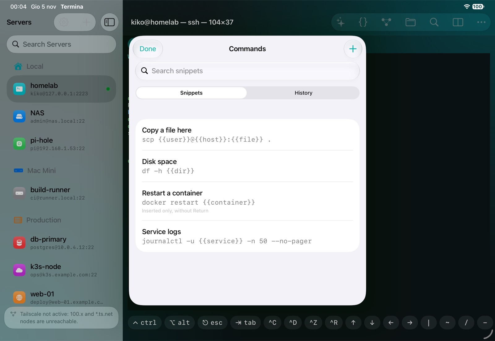

### 13. Import from ~/.ssh

If you already use `ssh` on a Mac or PC, bring your servers over in one go: touch and hold **+** in the
server list (on the Mac also **File → Import from ~/.ssh…**) and choose the `.ssh` folder. On the Mac it is in
your home folder and hidden: press **⌘⇧.** in the panel to see it. On iPhone and iPad copy it to iCloud Drive
first, or paste just the `config` file.

Termina reads `Host`, `HostName`, `User`, `Port`, `IdentityFile`, `ProxyJump`, `LocalForward`, `RemoteForward`
and `ForwardAgent`, includes the private keys, and trusts the Ed25519 host keys from `known_hosts` (hashed ones
too). You see a preview and pick what to import; servers you already have are unticked. Servers without a
key ask for the password on the first connection and remember it. Your files are never changed.

### 14. Jump hosts

For a server you can only reach through another one (a bastion): add the bastion as a normal server, then
edit the destination and choose it under **Routing → Jump Host**. Termina connects through it like `ssh -J`,
with a single Face ID, and the connection stays encrypted end to end. Chains of up to 4 hops are supported.

### 15. SSH agent forwarding

Turn on **Routing → Forward SSH Agent** for a server and programs running there, like `git` or `ssh`, can use
the key you logged in with, without the key ever being copied: for example `git pull` from GitHub with your
iPhone's key. `ssh-add -l` on the server shows it. Only enable it on servers you trust: while you are
connected, whoever controls the server can use the key. Works with Ed25519 and Secure Enclave keys.

### 16. Siri, Shortcuts and Spotlight

Termina's actions appear on their own, with your servers and snippets. There's nothing to set up:

- **Siri**: say “Connect to homelab with Termina” or “Open homelab in Termina”, using your server's name.
- **Shortcuts**: open Termina in the Shortcuts app. There's a button for each server and one for each snippet
  (it asks which server to run it on). You can use them in automations, widgets and with the Action button.
- **Spotlight**: type a server's name and tap it to connect (iOS 18 and later).

Termina always opens before connecting, so Face ID, host key confirmation and passwords work as usual. If a
snippet has values to fill in, the app asks for them before running it.

### 17. Two sessions side by side

On iPad and Mac you can keep two sessions on the same screen: for example a server's logs while you work on
another one.

1. During a session tap **Split** (the icon with two rectangles) in the toolbar and pick an open session or a
   saved server.
2. Tap a pane to type in it. The active pane has a coloured header and gets the keyboard, the Command Deck,
   files and tunnels.
3. From the same menu choose **Stacked** or **Side by Side**, or **Close Split** to go back to one session.

Each pane has its own size and the terminal adapts its columns and rows, also when the keyboard or the Files
panel opens. With a keyboard: **⌘D** splits with the next tab, **⌘⌥←** / **⌘⌥→** switch pane, **⇧⌘D** goes
back to one session. On iPhone and in narrow windows (Slide Over) only the active pane is shown.

### 18. Built-in guide

Every feature is explained step by step inside the app: **Settings → Guide**, the **How to Use Termina** link
on the welcome screen, or **Help → Termina Guide** (⌘?) on the Mac.

### Keyboard shortcuts

| Keys | Action |
|---|---|
| ⌘T / ⌘W | New tab / close tab |
| ⌘1…⌘9, ⇧⌘[ ⇧⌘] | Go to tab / previous / next |
| ⌘K | Clear screen and scrollback |
| ⌘F, ⌘G, ⇧⌘G | Find, next, previous |
| ⌘+ ⌘- ⌘0 | Text size |
| ⌘. | Esc |
| ⇧⌘T | Tunnels |
| ⇧⌘S | Snippets and history |
| ⌘D / ⇧⌘D | Split with the next tab / back to one session |
| ⌘⌥← ⌘⌥→ | Switch pane |
| ⇧⌘F, ⌘↑ | Files, parent folder |
| ⌘N / ⌘, | New server / Settings |
| ⌘R | Reconnect |

On iPad, hold **⌘** to see every shortcut.

## Security and privacy

- Passwords and private keys are stored only in your device's **Keychain**, protected by Face ID, Touch ID or your
  passcode. With iCloud sync on they also travel through your own iCloud, end-to-end encrypted: neither
  Apple nor the developer can read them.
- Secure Enclave keys are created inside the chip and **cannot be extracted**, not even by Termina.
- Every server's identity is checked (host key fingerprint) to protect you from man-in-the-middle attacks.
- No accounts, no analytics, no tracking: Termina connects only to the servers you add (and, with sync on, to your own iCloud).

Full policy: [Privacy](https://kikoz85.github.io/Termina/en/privacy.html).

## Troubleshooting

| Problem | What to do |
|---|---|
| "Credential not found in Keychain" | Open **Edit Server** from the session card and type the password or import the key again. |
| "Authentication failed" | Check user and password. For keys, make sure the public key is in `~/.ssh/authorized_keys` on the server. |
| "The host key has changed" | If you reinstalled the server, delete it from Termina and add it again. Otherwise do **not** connect. |
| `100.x.x.x` or `*.ts.net` unreachable | Turn on the Tailscale VPN on your device. |
| The connection drops in the background | Use a **tmux session** (see the guide, section 7). |
| Accented letters with Option don't work | Turn off **Option as Meta** in Settings. |
| A server doesn't appear on another device | Check you are signed in to iCloud with the same Apple Account, then **Settings → Sync Now**. |

## Support

- Help and contact: [Support page](https://kikoz85.github.io/Termina/en/support.html)
- Bugs and suggestions: open an [issue](https://github.com/kikoz85/Termina/issues) or write to enricofanucchi@gmail.com
- Support development: [GitHub Sponsors](https://github.com/sponsors/kikoz85)
- Developer: Enrico Fanucchi · [www.enricofanucchi.com](https://www.enricofanucchi.com)

© 2026 Enrico Fanucchi
